# GeoNodus demo apps

<p align="center">
  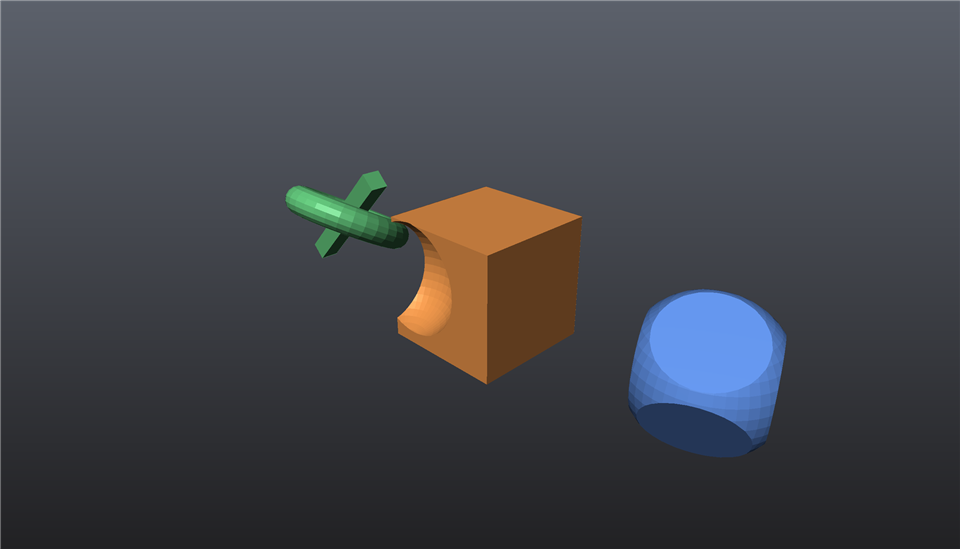
  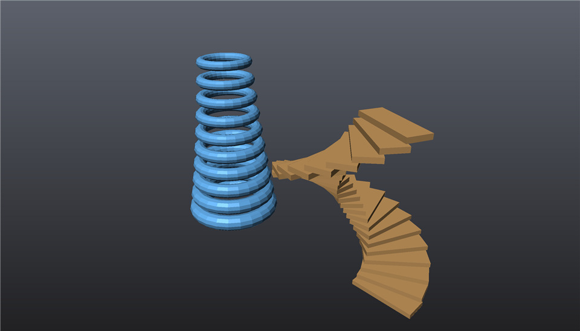
  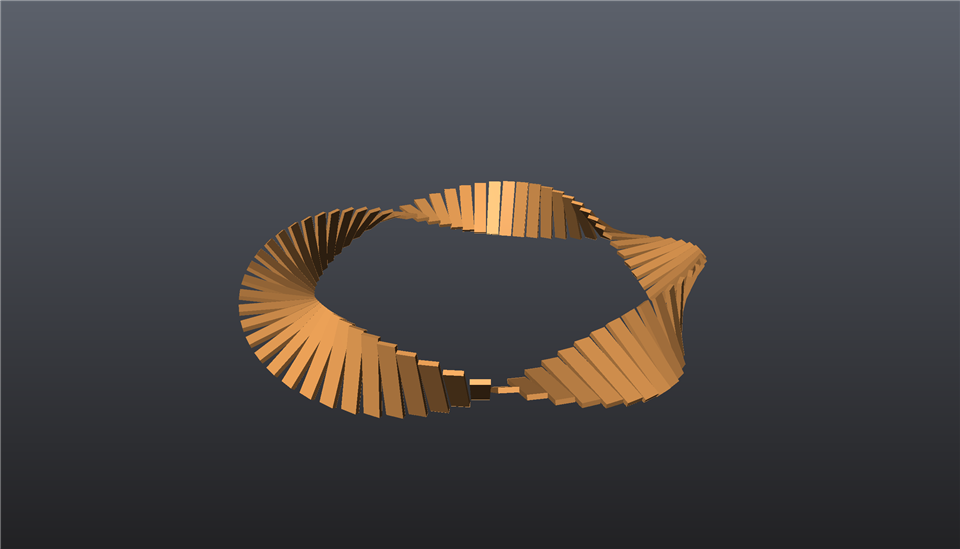
</p>

**GeoNodus** is a cross-platform C++23 shared library for **procedural geometry built from a node graph**. An
application creates a session, builds a graph of operators (generators, deformers, modeling tools, copies, curves,
Booleans, ...), connects them, sets and animates their parameters with expressions, and lets the library cook the
result in the background. The finished geometry — points, polygons, NURBS and Bezier curves, attributes and groups — is
read back through a plain C API and drawn by the application in any renderer.

This repository contains the **demo applications** of the library and the demo scenes they show: one scene for every
operator, built in code with the GeoNodus API. The library itself ships here as a binary of the demo edition.

> **Disclaimer.** GeoNodus is an independent project. It is **not affiliated with, endorsed by or connected to
> SideFX** or **Houdini** in any way, and it contains no SideFX code. Its public API only *follows the design* of the
> Houdini Engine API (HAPI): `HAPI_*` functions and types become `GN_*`, so the concepts and the calling patterns are
> familiar to anyone who has used HAPI. Houdini, Houdini Engine and HAPI are trademarks of SideFX.

## Contents

- [What the library does](#what-the-library-does)
- [Third-party libraries](#third-party-libraries)
- [Demo apps and platforms](#demo-apps-and-platforms)
- [Quick start with the C API](#quick-start-with-the-c-api)
- [Implemented features](#implemented-features)
  - [Generators](#generators): [Sphere](#sphere), [Box](#box), [Grid](#grid), [Torus](#torus), [Circle](#circle),
    [Add](#add)
  - [Attributes](#attributes): [Attribute Create](#attribute-create), [Attribute Randomize](#attribute-randomize),
    [Attribute Blur](#attribute-blur), [Normal](#normal), [UV Texture](#uv-texture)
  - [Groups](#groups): [Group Create](#group-create), [Group Range](#group-range)
  - [Deformers](#deformers): [Transform](#transform), [Mountain](#mountain), [Bend](#bend),
    [Path Deform](#path-deform), [Match Size](#match-size), [Fuse](#fuse)
  - [Modeling](#modeling): [Clip](#clip), [PolyExtrude](#polyextrude), [PolyBevel](#polybevel),
    [Boolean](#boolean)
  - [Copies and points](#copies-and-points): [Scatter](#scatter), [Copy to Points](#copy-to-points),
    [Copy and Transform](#copy-and-transform)
  - [Curves](#curves): [Fit](#fit), [Resample](#resample), [Carve](#carve), [Join](#join),
    [Orient along Curve](#orient-along-curve)
  - [Networks and objects](#networks-and-objects): [Merge](#merge), [Null](#null), [Subnet](#subnet),
    [Output](#output), [Geo objects](#geo-objects), [Null objects](#null-objects)
  - [Geometry from the application](#geometry-from-the-application): [Input nodes](#input-nodes),
    [Input nodes and Boolean](#input-nodes-and-boolean)

## What the library does

- **Sessions and a node graph.** Every session owns its own graph with the root `/obj`. Objects (`geo`, `null`) live on
  `/obj`, geometry operators (SOPs) live inside `geo` objects and SOP subnets. Nodes are connected input to output;
  cycles are rejected.
- **Parameters as in HAPI.** Every node publishes its parameters — ints, floats, toggles, menus, strings, file paths,
  ramps, multiparms, folders and tabs with hide/disable conditions — through `gnGetParameters` and flat value arrays
  (`gnGetParmFloatValues`, `gnSetParmIntValues`, ...). User (spare) parameters can be added to any node.
- **Expressions and time.** Any parameter component can carry an expression of time (`$T`, `$F`, `$FPS`, ...) and of
  other parameters (`ch("../ctrl/radius")`). Only the nodes that depend on what changed are cooked again.
- **Asynchronous cook.** `gnCookNode` does not block: the cook runs on the job thread of the session, the application
  polls `gnGetCookState` or waits with `gnWaitCook`. Dirty propagation, skipped up-to-date nodes and copy-on-write
  geometry pages keep re-cooking cheap.
- **Geometry.** Points, vertices, polygons and polylines, NURBS and Bezier curves; point, vertex, primitive and detail
  attributes of any type (int, float, double, string); point, primitive and edge groups. Everything is read through
  HAPI-style parts, attribute and curve queries (`gnGetPartInfo`, `gnGetAttributeFloatData`, `gnGetCurveKnots`, ...).
- **Geometry from the application.** `gnCreateInputNode` and the geometry setters (`gnSetPartInfo`, `gnAddAttribute`,
  `gnSetVertexList`, `gnSetCurveInfo`, `gnCommitGeo`, ...) hand meshes and curves made by the application to the graph.
- **Saving and loading graphs.** The whole graph — nodes, parameters, expressions, connections, user parameters, input
  geometry and time — is stored as JSON (`gnSaveGraph`, `gnLoadGraph`).
- **Results checked against references.** The behavior of every operator is verified by tests against reference data,
  so the results match what users of procedural tools expect.

The demo edition of the library, included in this repository, creates at most 20 nodes per scene through
`gnCreateNode` and cannot save graphs (`gnSaveGraph` returns `GN_RESULT_DEMO_LIMIT`). Everything else works.

## Third-party libraries

GeoNodus is built on these open-source libraries (linked statically into the library):

| Library | Used for | License |
|---|---|---|
| [oneTBB](https://github.com/uxlfoundation/oneTBB) | parallel cooking of geometry, the scalable memory allocator | Apache 2.0 |
| [Manifold](https://github.com/elalish/manifold) | the robust mesh Boolean kernel of the Boolean operator | Apache 2.0 |
| [muParser](https://github.com/beltoforion/muparser) | parameter expressions | BSD 2-Clause |
| [simdjson](https://github.com/simdjson/simdjson) | reading graphs and geometry from JSON | Apache 2.0 / MIT |

## Demo apps and platforms

| Folder | Platform | Renderer |
|---|---|---|
| `win/gl` | Windows x64 and ARM64 | OpenGL 3.3 core |
| `win/vulkan` | Windows x64 and ARM64 | Vulkan 1.0 |
| `mac/metal` | macOS 12+ (Apple Silicon) | Metal (Swift, AppKit + MetalKit) |
| `iOS/metal` | iOS / iPadOS 15+ (device and simulator) | Metal (Swift, UIKit + MetalKit) |
| `scenes` | all platforms | the demo scenes in plain C++ over `geonodus.h` |

Every app has the same controls: open a graph file, pick a demo scene by node type, play the animation in real time or
scrub the timeline, orbit / zoom / pan the camera (F — frame everything). The binaries of the demo edition of the
library are in `win/lib`, `mac/lib` and `iOS/lib`.

```bash
# Windows (from a Visual Studio developer prompt)
cmake -S win/gl -B win/gl/build/release -G Ninja -DCMAKE_BUILD_TYPE=Release
cmake --build win/gl/build/release
win/gl/build/release/geonodus_gl.exe --scene boolean --play
```

```bash
# macOS
cmake -S mac/metal -B mac/metal/build/xcode -G Xcode
cmake --build mac/metal/build/xcode --config Release
```

On iOS open `iOS/GeoNodusMetalDemo.xcodeproj` in Xcode, choose a signing team and run.

## Quick start with the C API

The whole API is C: functions `gn*` in `geonodus.h`, types and enums `GN_*` in `geonodus_API.h`. As in HAPI, a node
publishes its parameters as a list (`gnGetParameters`); every parameter knows its id and its index in the flat arrays of
int, float and string values. Three small helpers, written only with API calls, find a parameter by name and choose a
menu item by its token — the feature examples below use them:

```cpp
#include <geonodus.h>
#include <string>
#include <vector>

// A string of the session string table: as in HAPI, first the length, then the string
std::string getString(GN_SessionId s, GN_StringHandle handle)
{
    int length = 0;
    gnGetStringBufLength(s, handle, &length);
    std::string text(length, '\0');
    gnGetString(s, handle, text.data(), length);
    return text.c_str();
}

// A parameter by name: id (for expressions and strings) and intValuesIndex / floatValuesIndex (for values)
GN_ParmInfo findParm(GN_SessionId s, GN_NodeId node, const char* name)
{
    GN_NodeInfo info{};
    gnGetNodeInfo(s, node, &info);
    std::vector<GN_ParmInfo> parms(info.parmCount);
    gnGetParameters(s, node, parms.data(), 0, info.parmCount);
    for (const GN_ParmInfo& p : parms)
        if (getString(s, p.nameSH) == name)
            return p;
    GN_ParmInfo none{};
    none.id = -1;
    return none;
}

// A menu item by its token: the value of a menu parameter is the index of the item
void setMenu(GN_SessionId s, GN_NodeId node, const char* name, const char* token)
{
    const GN_ParmInfo p = findParm(s, node, name);
    std::vector<GN_ParmChoiceInfo> items(p.choiceCount);
    gnGetParmChoiceLists(s, node, items.data(), p.choiceIndex, p.choiceCount);
    for (int i = 0; i < p.choiceCount; ++i)
        if (getString(s, items[i].valueSH) == token)
            gnSetParmIntValues(s, node, &i, p.intValuesIndex, 1);
}
```

A complete program — a grid displaced by animated noise, cooked and read back:

```cpp
int main()
{
    GN_SessionId s;
    gnCreateSession(&s);

    GN_NodeId geo, grid, noise;
    gnCreateNode(s, 0, "geo", "terrain", false, &geo);        // an object on the root /obj (id 0)
    gnCreateNode(s, geo, "grid", "land", false, &grid);       // SOPs inside the object
    gnCreateNode(s, geo, "mountain", "noise", false, &noise);
    gnConnectNodeInput(s, noise, 0, grid, 0);
    gnSetNodeDisplay(s, noise, 1);                            // the SOP the object outputs

    const float size[] = {10, 10};
    gnSetParmFloatValues(s, grid, size, findParm(s, grid, "size").floatValuesIndex, 2);
    const int rows = 80;
    gnSetParmIntValues(s, grid, &rows, findParm(s, grid, "rows").intValuesIndex, 1);
    // An expression on a parameter component: $T — seconds, $F — frame, ch("path") — another parameter
    gnSetParmExpression(s, noise, "1 + 0.5 * sin($T)", findParm(s, noise, "height").id, 0);

    gnSetTime(s, 2.0);
    GN_CookOptions options = gnCookOptions_Create();
    gnCookNode(s, geo, &options);                             // non-blocking: queued on the session's job thread
    gnWaitCook(s, geo, -1);

    GN_GeoInfo geoInfo;
    gnGetDisplayGeoInfo(s, geo, &geoInfo);
    GN_PartInfo part;
    gnGetPartInfo(s, geoInfo.nodeId, 0, &part);
    GN_AttributeInfo pInfo;
    gnGetAttributeInfo(s, geoInfo.nodeId, 0, "P", GN_ATTROWNER_POINT, &pInfo);
    std::vector<float> P(pInfo.count * 3);
    gnGetAttributeFloatData(s, geoInfo.nodeId, 0, "P", &pInfo, -1, P.data(), 0, pInfo.count);
    std::vector<int> vertices(part.vertexCount);              // triangles: 3 points per face by default
    gnGetVertexList(s, geoInfo.nodeId, 0, vertices.data(), 0, part.vertexCount);

    gnCloseSession(s);
}
```

The examples below assume a session `s`, a geo object `geo` (`gnCreateNode(s, 0, "geo", "geo1", false, &geo)`) and
the helpers above. Toggles are int parameters (0 / 1). Cook and read the result as in the program above. The demo app
shows every feature in a scene of its own; the code of the scenes is in [`scenes/`](scenes).

## Implemented features

### Generators

#### Sphere

`sphere` — a polygon mesh sphere (rows × columns) or a subdivided icosahedron; with a connected input — the bounding
sphere of the input points.

```cpp
GN_NodeId sphere;
gnCreateNode(s, geo, "sphere", "sphere1", false, &sphere);
setMenu(s, sphere, "type", "polymesh");                       // "poly" — an icosahedron subdivided by "freq"
const int rows = 24, cols = 48;
gnSetParmIntValues(s, sphere, &rows, findParm(s, sphere, "rows").intValuesIndex, 1);
gnSetParmIntValues(s, sphere, &cols, findParm(s, sphere, "cols").intValuesIndex, 1);
const float rad[] = {2, 1.5, 2};
gnSetParmFloatValues(s, sphere, rad, findParm(s, sphere, "rad").floatValuesIndex, 3);

// The bounding sphere of other geometry: connect it to the input
gnConnectNodeInput(s, sphere, 0, otherSop, 0);
```

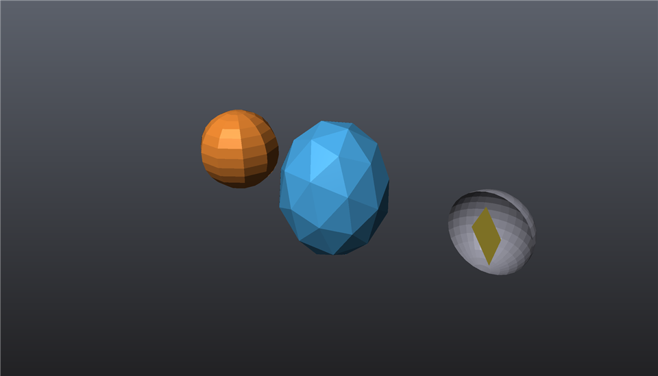

#### Box

`box` — a box of a given size and number of points along each axis; with a connected input — the bounding box of the
input.

```cpp
GN_NodeId box;
gnCreateNode(s, geo, "box", "box1", false, &box);
const float size[] = {2, 1, 3};
gnSetParmFloatValues(s, box, size, findParm(s, box, "size").floatValuesIndex, 3);
const int divisions[] = {4, 2, 6};                            // points along X, Y, Z
gnSetParmIntValues(s, box, divisions, findParm(s, box, "divrate").intValuesIndex, 3);
gnSetParmExpression(s, box, "$T * 45", findParm(s, box, "r").id, 1);   // rotation about Y animated
```

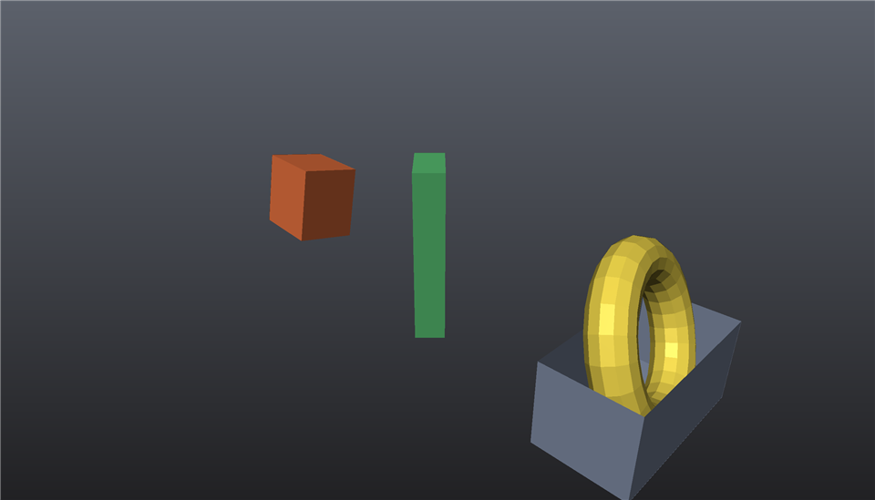

#### Grid

`grid` — a grid of rows × columns of any connectivity: quadrilaterals, triangles, alternating triangles, rows,
columns, rows and columns.

```cpp
GN_NodeId grid;
gnCreateNode(s, geo, "grid", "grid1", false, &grid);
const float size[] = {8, 4};
gnSetParmFloatValues(s, grid, size, findParm(s, grid, "size").floatValuesIndex, 2);
const int rows = 20, cols = 40;
gnSetParmIntValues(s, grid, &rows, findParm(s, grid, "rows").intValuesIndex, 1);
gnSetParmIntValues(s, grid, &cols, findParm(s, grid, "cols").intValuesIndex, 1);
setMenu(s, grid, "surftype", "triangles");                    // "quads", "alttriangles", "rows", "rowcol", ...
setMenu(s, grid, "orient", "xy");
```

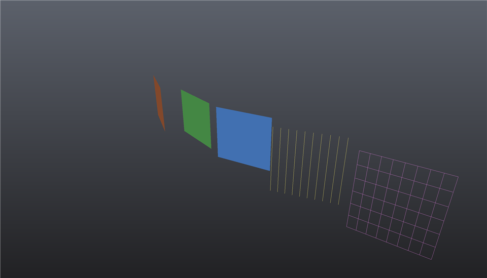

#### Torus

`torus` — a torus with ring and tube radii and rows × columns of quadrilaterals.

```cpp
GN_NodeId torus;
gnCreateNode(s, geo, "torus", "torus1", false, &torus);
const float rad[] = {2, 0.5f};                                // ring radius, tube radius
gnSetParmFloatValues(s, torus, rad, findParm(s, torus, "rad").floatValuesIndex, 2);
const int rows = 16, cols = 48;
gnSetParmIntValues(s, torus, &rows, findParm(s, torus, "rows").intValuesIndex, 1);
gnSetParmIntValues(s, torus, &cols, findParm(s, torus, "cols").intValuesIndex, 1);
```

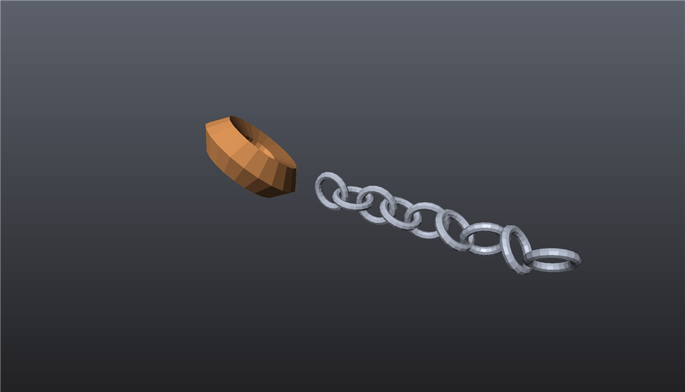

#### Circle

`circle` — polygon circles and arcs (closed, open arc, closed arc, sliced arc) and exact rational NURBS and Bezier
circles.

```cpp
GN_NodeId pie, nurbs;
gnCreateNode(s, geo, "circle", "pie", false, &pie);
setMenu(s, pie, "arc", "slicedarc");                          // "openarc", "closedarc"
const int divs = 24;
gnSetParmIntValues(s, pie, &divs, findParm(s, pie, "divs").intValuesIndex, 1);
const float angle[] = {0, 270};
gnSetParmFloatValues(s, pie, angle, findParm(s, pie, "angle").floatValuesIndex, 2);

gnCreateNode(s, geo, "circle", "nurbs", false, &nurbs);
setMenu(s, nurbs, "type", "nurbs");                           // "bezier"
const int imperfect = 0, order = 3;                           // an exact circle of rational quadratic segments
gnSetParmIntValues(s, nurbs, &imperfect, findParm(s, nurbs, "imperfect").intValuesIndex, 1);
gnSetParmIntValues(s, nurbs, &order, findParm(s, nurbs, "order").intValuesIndex, 1);
```

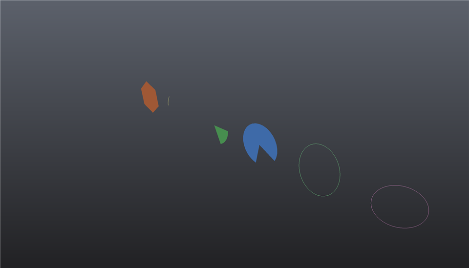

#### Add

`add` — points given one by one (the `points` multiparm: `pt0`, `pt1`, ...) and polygons or polylines through them by
a pattern of point numbers (the `prims` multiparm).

```cpp
GN_NodeId add;
gnCreateNode(s, geo, "add", "add1", false, &add);
const int pointCount = 4;                                     // the value of a multiparm is its number of instances
gnSetParmIntValues(s, add, &pointCount, findParm(s, add, "points").intValuesIndex, 1);
const float pts[4][3] = {{0, 0, 0}, {2, 0, 0}, {2, 2, 0}, {0, 2, 0}};
for (int i = 0; i < 4; ++i) {
    const std::string name = "pt" + std::to_string(i);        // instances of Add are numbered from 0
    gnSetParmFloatValues(s, add, pts[i], findParm(s, add, name.c_str()).floatValuesIndex, 3);
}
gnSetParmExpression(s, add, "1 + sin($T)", findParm(s, add, "pt2").id, 1);   // a point moved by an expression

const int primCount = 1, closed = 1;
gnSetParmIntValues(s, add, &primCount, findParm(s, add, "prims").intValuesIndex, 1);
gnSetParmStringValue(s, add, "0-3", findParm(s, add, "prim0").id, 0);        // points 0, 1, 2, 3
gnSetParmIntValues(s, add, &closed, findParm(s, add, "closed0").intValuesIndex, 1);
```

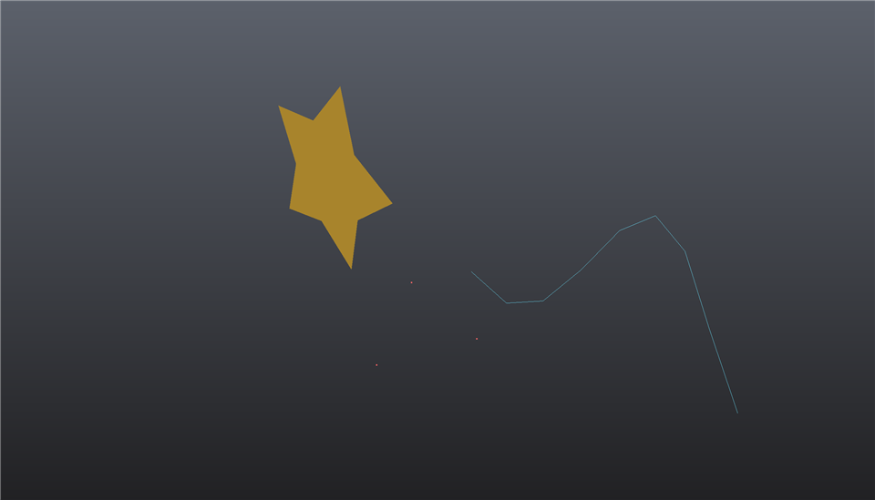

### Attributes

#### Attribute Create

`attribcreate` — attributes of any class (point, vertex, primitive, detail), type and size, one per instance of the
`numattr` multiparm; values can be written to the elements of a group only.

```cpp
GN_NodeId create;
gnCreateNode(s, geo, "attribcreate", "color", false, &create);
gnConnectNodeInput(s, create, 0, input, 0);
gnSetParmStringValue(s, create, "Cd", findParm(s, create, "name1").id, 0);
setMenu(s, create, "class1", "point");                        // "vertex", "primitive", "detail"
setMenu(s, create, "type1", "vector");                        // "float", "int", "index" (a string), ...
const int tupleSize = 3;
gnSetParmIntValues(s, create, &tupleSize, findParm(s, create, "size1").intValuesIndex, 1);
const float value[] = {1, 0.5f, 0.2f, 0};
gnSetParmFloatValues(s, create, value, findParm(s, create, "value1v").floatValuesIndex, 4);

// Only the points 0..99 get the value
gnSetParmStringValue(s, create, "0-99", findParm(s, create, "group").id, 0);
setMenu(s, create, "grouptype", "points");
```

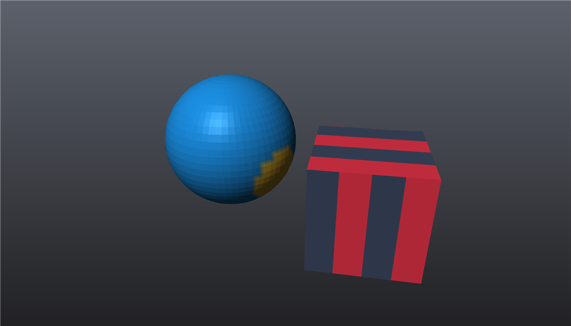

#### Attribute Randomize

`attribrandomize` — random values of an attribute within a range (set, add, min, max or multiply), repeatable by a
seed.

```cpp
GN_NodeId rnd;
gnCreateNode(s, geo, "attribrandomize", "random_scale", false, &rnd);
gnConnectNodeInput(s, rnd, 0, points, 0);
gnSetParmStringValue(s, rnd, "pscale", findParm(s, rnd, "name").id, 0);
const int dimensions = 1;
gnSetParmIntValues(s, rnd, &dimensions, findParm(s, rnd, "dimensions").intValuesIndex, 1);
const float minValue[] = {0.1f, 0, 0, 0}, maxValue[] = {0.5f, 0, 0, 0};
gnSetParmFloatValues(s, rnd, minValue, findParm(s, rnd, "min").floatValuesIndex, 4);
gnSetParmFloatValues(s, rnd, maxValue, findParm(s, rnd, "max").floatValuesIndex, 4);
const float seed = 7;
gnSetParmFloatValues(s, rnd, &seed, findParm(s, rnd, "seed").floatValuesIndex, 1);
```

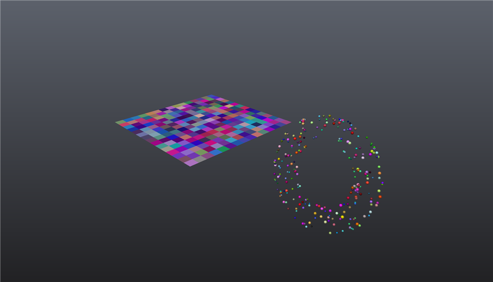

#### Attribute Blur

`attribblur` — smoothing of point attributes over the connections of the mesh (or by proximity): colors, weights or
the positions themselves, Laplacian or volume preserving.

```cpp
GN_NodeId blur;
gnCreateNode(s, geo, "attribblur", "smooth", false, &blur);
gnConnectNodeInput(s, blur, 0, input, 0);
gnSetParmStringValue(s, blur, "P Cd", findParm(s, blur, "attributes").id, 0);  // names separated by spaces
setMenu(s, blur, "mode", "volpreserving");
const int iterations = 20;
gnSetParmIntValues(s, blur, &iterations, findParm(s, blur, "iterations").intValuesIndex, 1);
```

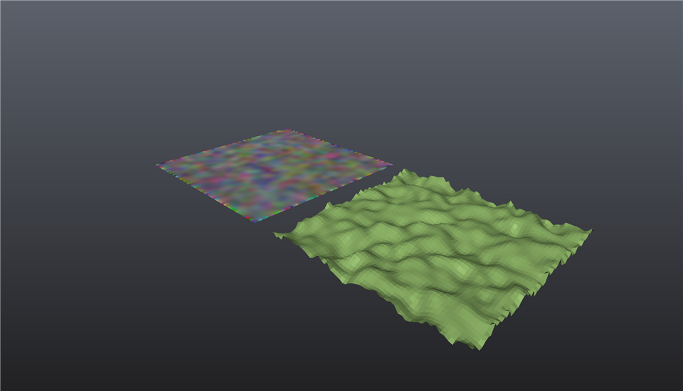

#### Normal

`normal` — normals of points, vertices (with a cusp angle), primitives or the detail, weighted equally, by angle or by
area.

```cpp
GN_NodeId normal;
gnCreateNode(s, geo, "normal", "normal1", false, &normal);
gnConnectNodeInput(s, normal, 0, input, 0);
setMenu(s, normal, "type", "typepoint");                      // point normals
setMenu(s, normal, "method", "area");                         // weighted by face area

// After the cook: N of the points
GN_AttributeInfo nInfo;
gnGetAttributeInfo(s, normal, 0, "N", GN_ATTROWNER_POINT, &nInfo);
std::vector<float> N(nInfo.count * 3);
gnGetAttributeFloatData(s, normal, 0, "N", &nInfo, -1, N.data(), 0, nInfo.count);
```

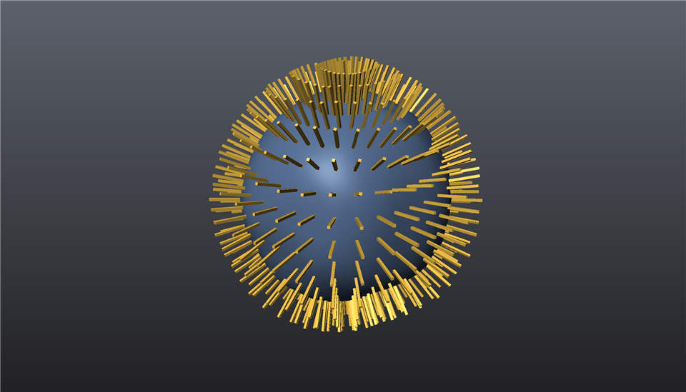

#### UV Texture

`texture` — texture coordinates by orthographic, polar, cylindrical, rows-and-columns, face and spline projections,
with scale and offset.

```cpp
GN_NodeId uv;
gnCreateNode(s, geo, "texture", "uv1", false, &uv);
gnConnectNodeInput(s, uv, 0, input, 0);
setMenu(s, uv, "type", "polar");                              // "cylin", "rowcol", ...
gnSetParmStringValue(s, uv, "uv", findParm(s, uv, "uvattrib").id, 0);
const float scale[] = {2, 1, 1}, offset[] = {0.25f, 0, 0};
gnSetParmFloatValues(s, uv, scale, findParm(s, uv, "s").floatValuesIndex, 3);
gnSetParmFloatValues(s, uv, offset, findParm(s, uv, "offset").floatValuesIndex, 3);
```

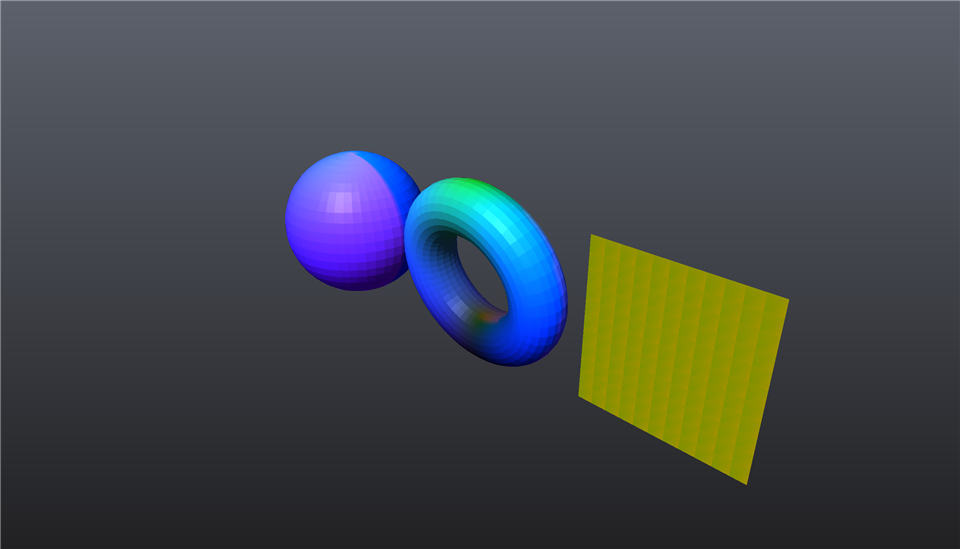

### Groups

#### Group Create

`groupcreate` — point, primitive and edge groups by bounding regions (box, sphere), by normals, by edge rules and by
random chance. Groups are read back with `gnGetGroupNames` and `gnGetGroupMembership`.

```cpp
GN_NodeId group;
gnCreateNode(s, geo, "groupcreate", "in_box", false, &group);
gnConnectNodeInput(s, group, 0, input, 0);
gnSetParmStringValue(s, group, "inbox", findParm(s, group, "groupname").id, 0);
setMenu(s, group, "grouptype", "point");
const int off = 0, on = 1;
gnSetParmIntValues(s, group, &off, findParm(s, group, "groupbase").intValuesIndex, 1);
gnSetParmIntValues(s, group, &on, findParm(s, group, "groupbounding").intValuesIndex, 1);
setMenu(s, group, "boundtype", "usebbox");                    // "usebsphere"
const float boxSize[] = {2, 2, 2}, boxCenter[] = {1, 0, 0};
gnSetParmFloatValues(s, group, boxSize, findParm(s, group, "size").floatValuesIndex, 3);
gnSetParmFloatValues(s, group, boxCenter, findParm(s, group, "t").floatValuesIndex, 3);

// After the cook: membership of the points of part 0
GN_PartInfo part;
gnGetPartInfo(s, group, 0, &part);
std::vector<int> inGroup(part.pointCount);
gnGetGroupMembership(s, group, 0, GN_GROUPTYPE_POINT, "inbox", nullptr, inGroup.data(), 0, part.pointCount);
```

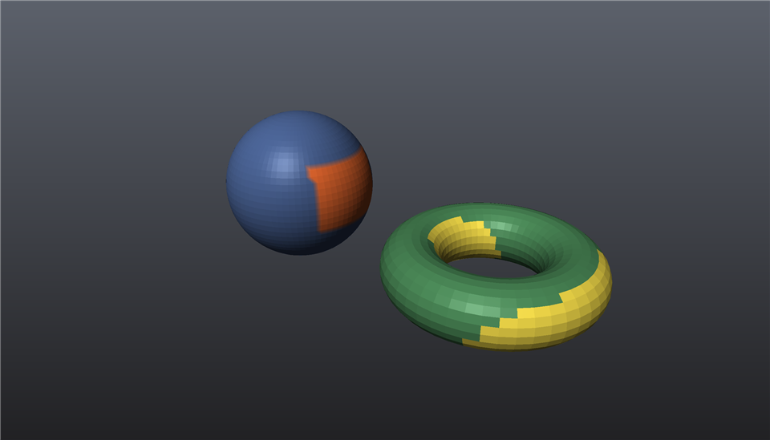

#### Group Range

`grouprange` — groups by ranges of element numbers: start and end, start and length, every N of M with an offset,
equal partitions, ranges inside every connected piece.

```cpp
GN_NodeId range;
gnCreateNode(s, geo, "grouprange", "every_third", false, &range);
gnConnectNodeInput(s, range, 0, input, 0);
gnSetParmStringValue(s, range, "stripes", findParm(s, range, "groupname1").id, 0);
setMenu(s, range, "grouptype1", "prims");
const int amount = 1, total = 3, offset = 1;                  // 1 of every 3 primitives, starting from 1
gnSetParmIntValues(s, range, &amount, findParm(s, range, "selectamount1").intValuesIndex, 1);
gnSetParmIntValues(s, range, &total, findParm(s, range, "selecttotal1").intValuesIndex, 1);
gnSetParmIntValues(s, range, &offset, findParm(s, range, "selectoffset1").intValuesIndex, 1);
```

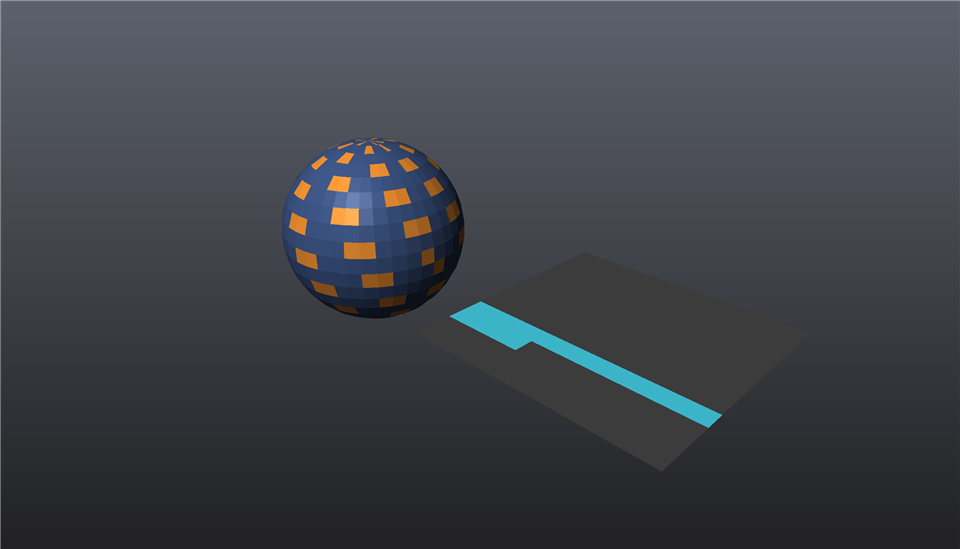

### Deformers

#### Transform

`xform` — translate, rotate, scale, shear, pivot and pre-transform of the whole geometry or of a group; vectors,
normals and other attributes are transformed according to their type.

```cpp
GN_NodeId xform;
gnCreateNode(s, geo, "xform", "move", false, &xform);
gnConnectNodeInput(s, xform, 0, input, 0);
const float t[] = {0, 1, 0}, r[] = {0, 45, 0}, scale[] = {1, 2, 1}, pivot[] = {0, -1, 0};
gnSetParmFloatValues(s, xform, t, findParm(s, xform, "t").floatValuesIndex, 3);
gnSetParmFloatValues(s, xform, r, findParm(s, xform, "r").floatValuesIndex, 3);
gnSetParmFloatValues(s, xform, scale, findParm(s, xform, "s").floatValuesIndex, 3);
gnSetParmFloatValues(s, xform, pivot, findParm(s, xform, "p").floatValuesIndex, 3);

// Only a part of the points: a group pattern
gnSetParmStringValue(s, xform, "0-120", findParm(s, xform, "group").id, 0);
setMenu(s, xform, "grouptype", "points");
```

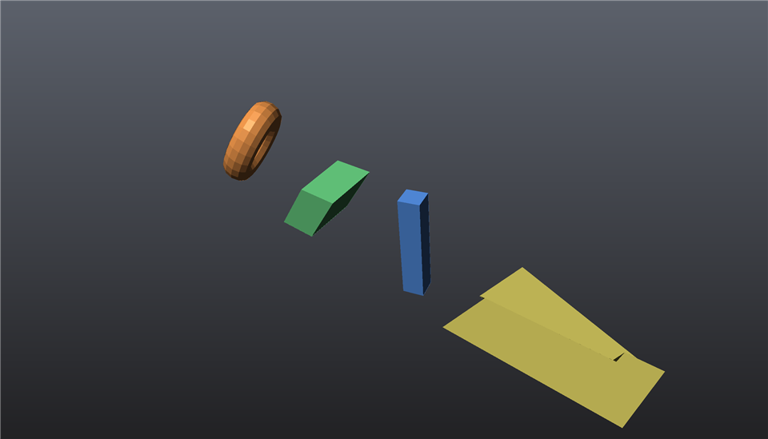

#### Mountain

`mountain` — displacement along the normal by fractal noise (Perlin, simplex, Worley, alligator, ...), which can flow
in time.

```cpp
GN_NodeId mountain;
gnCreateNode(s, geo, "mountain", "noise", false, &mountain);
gnConnectNodeInput(s, mountain, 0, input, 0);
const float height = 1.5f, elementSize = 3;
gnSetParmFloatValues(s, mountain, &height, findParm(s, mountain, "height").floatValuesIndex, 1);
gnSetParmFloatValues(s, mountain, &elementSize, findParm(s, mountain, "elementsize").floatValuesIndex, 1);
const int octaves = 6;
gnSetParmIntValues(s, mountain, &octaves, findParm(s, mountain, "oct").intValuesIndex, 1);
setMenu(s, mountain, "basis", "worleyFA");
gnSetParmExpression(s, mountain, "$T * 0.3", findParm(s, mountain, "time").id, 0);   // the noise flows
```

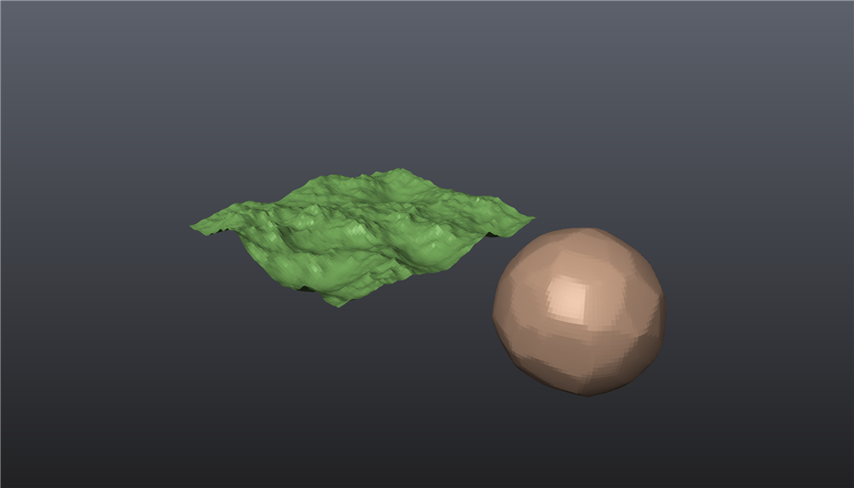

#### Bend

`bend` — bends, twists, tapers and squashes geometry inside a capture region; bending by an angle or towards a goal
direction.

```cpp
GN_NodeId bend;
gnCreateNode(s, geo, "bend", "bend1", false, &bend);
gnConnectNodeInput(s, bend, 0, input, 0);
const float origin[] = {0, 0, 0}, dir[] = {0, 1, 0}, length = 6;   // the capture region
gnSetParmFloatValues(s, bend, origin, findParm(s, bend, "origin").floatValuesIndex, 3);
gnSetParmFloatValues(s, bend, dir, findParm(s, bend, "dir").floatValuesIndex, 3);
gnSetParmFloatValues(s, bend, &length, findParm(s, bend, "length").floatValuesIndex, 1);
const float angle = 120;
gnSetParmFloatValues(s, bend, &angle, findParm(s, bend, "bend").floatValuesIndex, 1);
const int twistOn = 1;
const float twist = 90;
gnSetParmIntValues(s, bend, &twistOn, findParm(s, bend, "enabletwist").intValuesIndex, 1);
gnSetParmFloatValues(s, bend, &twist, findParm(s, bend, "twist").floatValuesIndex, 1);
```

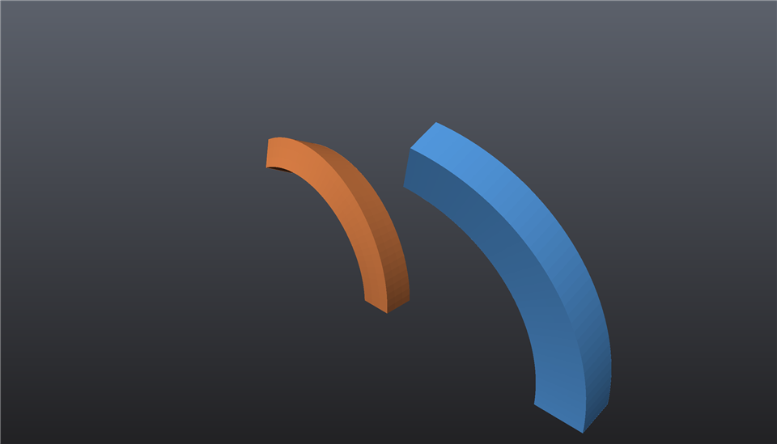

#### Path Deform

`pathdeform` — lays geometry along a curve from the second input: position and length on the curve, ramps of scale
and roll, stretching and rigid pieces.

```cpp
GN_NodeId deform;
gnCreateNode(s, geo, "pathdeform", "along_path", false, &deform);
gnConnectNodeInput(s, deform, 0, shape, 0);
gnConnectNodeInput(s, deform, 1, curve, 0);                   // the path
setMenu(s, deform, "curve_endunit", "fractioncurvelength");
const float end = 0.8f, roll = 180;
gnSetParmFloatValues(s, deform, &end, findParm(s, deform, "curve_posend").floatValuesIndex, 1);
gnSetParmExpression(s, deform, "$T * 0.1", findParm(s, deform, "curve_posoffset").id, 0);   // slides along
const int on = 1;
gnSetParmIntValues(s, deform, &on, findParm(s, deform, "rotate_enable").intValuesIndex, 1);
gnSetParmFloatValues(s, deform, &roll, findParm(s, deform, "rotate_angle").floatValuesIndex, 1);

// A ramp is a multiparm of keys: three keys of the scale along the curve
gnSetParmIntValues(s, deform, &on, findParm(s, deform, "taper_enable").intValuesIndex, 1);
gnSetParmIntValues(s, deform, &on, findParm(s, deform, "taper_enableramp").intValuesIndex, 1);
const int keys = 3;
gnSetParmIntValues(s, deform, &keys, findParm(s, deform, "taper_ramp").intValuesIndex, 1);
const float pos = 0.5f, value = 2;
gnSetParmFloatValues(s, deform, &pos, findParm(s, deform, "taper_ramp3pos").floatValuesIndex, 1);
gnSetParmFloatValues(s, deform, &value, findParm(s, deform, "taper_ramp3value").floatValuesIndex, 1);
```

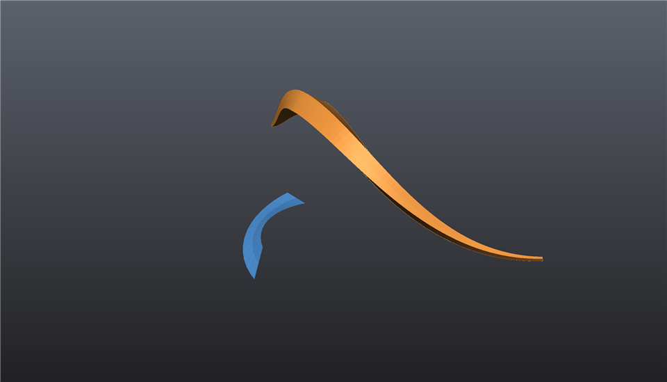

#### Match Size

`matchsize` — fits geometry into a target box (given explicitly, by the second input or at the origin): justify and
scale per axis, uniformly or by perimeter, area or volume.

```cpp
GN_NodeId match;
gnCreateNode(s, geo, "matchsize", "fit_box", false, &match);
gnConnectNodeInput(s, match, 0, input, 0);
setMenu(s, match, "justifytarget", "explicit");
const float center[] = {0, 1, 0}, size[] = {2, 2, 2};
gnSetParmFloatValues(s, match, center, findParm(s, match, "t").floatValuesIndex, 3);
gnSetParmFloatValues(s, match, size, findParm(s, match, "size").floatValuesIndex, 3);
const int on = 1, off = 0;
gnSetParmIntValues(s, match, &on, findParm(s, match, "doscale").intValuesIndex, 1);
gnSetParmIntValues(s, match, &off, findParm(s, match, "uniformscale").intValuesIndex, 1);   // stretch per axis
```

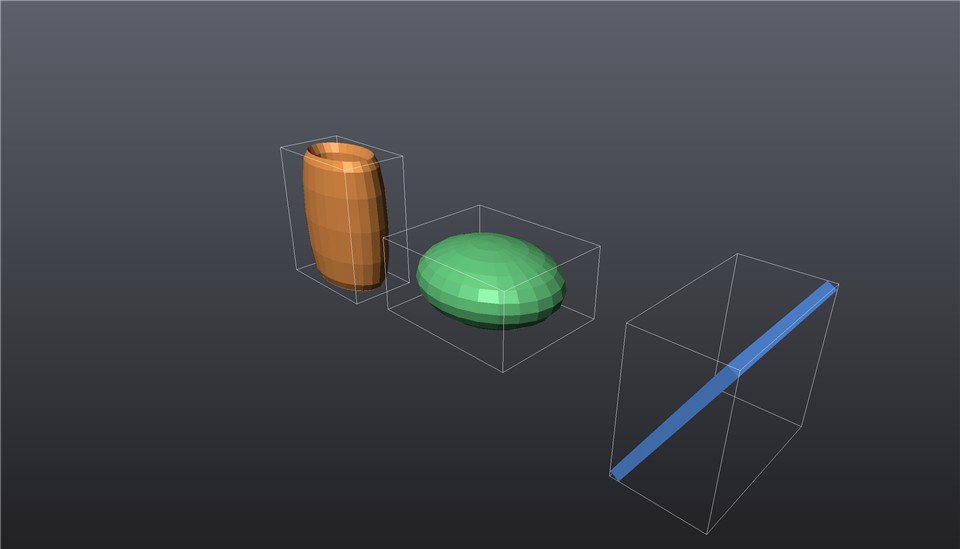

#### Fuse

`fuse` — merges points within a distance or snaps them to a grid; degenerate faces are removed, attributes of merged
points are combined by a chosen method.

```cpp
GN_NodeId fuse, snap;
gnCreateNode(s, geo, "fuse", "fuse1", false, &fuse);
gnConnectNodeInput(s, fuse, 0, input, 0);
const float distance = 0.05f;
gnSetParmFloatValues(s, fuse, &distance, findParm(s, fuse, "tol3d").floatValuesIndex, 1);

gnCreateNode(s, geo, "fuse", "snap", false, &snap);
gnConnectNodeInput(s, snap, 0, input, 0);
setMenu(s, snap, "snaptype", "gridsnap");
const float spacing[] = {0.25f, 0.25f, 0.25f};
gnSetParmFloatValues(s, snap, spacing, findParm(s, snap, "gridspacing").floatValuesIndex, 3);
```

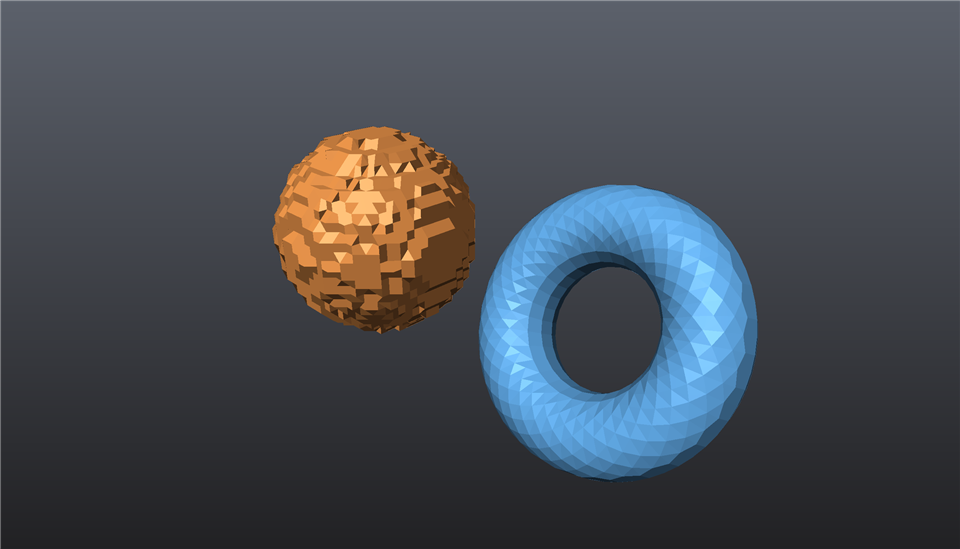

### Modeling

#### Clip

`clip` — cuts polygons and polylines by a plane, keeps the part above, below or both, and closes the cut with a cap.

```cpp
GN_NodeId clip;
gnCreateNode(s, geo, "clip", "clip1", false, &clip);
gnConnectNodeInput(s, clip, 0, input, 0);
const float origin[] = {0, 0, 0}, normal[] = {0.3f, 1, 0}, distance = 0.5f;
gnSetParmFloatValues(s, clip, origin, findParm(s, clip, "origin").floatValuesIndex, 3);
gnSetParmFloatValues(s, clip, normal, findParm(s, clip, "dir").floatValuesIndex, 3);
gnSetParmFloatValues(s, clip, &distance, findParm(s, clip, "dist").floatValuesIndex, 1);
setMenu(s, clip, "clipop", "below");                          // "above", "both"
const int cap = 1;
gnSetParmIntValues(s, clip, &cap, findParm(s, clip, "dofill").intValuesIndex, 1);
```

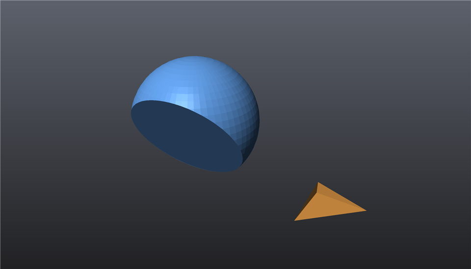

#### PolyExtrude

`polyextrude` — extrudes faces (together or as individual elements) and open curves: distance, inset, divisions,
twist, front transform, thickness and twist ramps, extrusion along a curve, UVs of the sides.

```cpp
GN_NodeId extrude;
gnCreateNode(s, geo, "polyextrude", "extrude1", false, &extrude);
gnConnectNodeInput(s, extrude, 0, input, 0);
gnSetParmStringValue(s, extrude, "0-9", findParm(s, extrude, "group").id, 0);   // primitives 0..9
setMenu(s, extrude, "splittype", "elements");                 // every face on its own
const float distance = 0.5f, inset = 0.1f, twist = 45;
gnSetParmFloatValues(s, extrude, &distance, findParm(s, extrude, "dist").floatValuesIndex, 1);
gnSetParmFloatValues(s, extrude, &inset, findParm(s, extrude, "inset").floatValuesIndex, 1);
gnSetParmFloatValues(s, extrude, &twist, findParm(s, extrude, "twist").floatValuesIndex, 1);
const int divisions = 4, frontXform = 1;
gnSetParmIntValues(s, extrude, &divisions, findParm(s, extrude, "divs").intValuesIndex, 1);
gnSetParmIntValues(s, extrude, &frontXform, findParm(s, extrude, "xformfront").intValuesIndex, 1);
const float frontScale[] = {0.5f, 1, 0.5f};
gnSetParmFloatValues(s, extrude, frontScale, findParm(s, extrude, "scale").floatValuesIndex, 3);
```

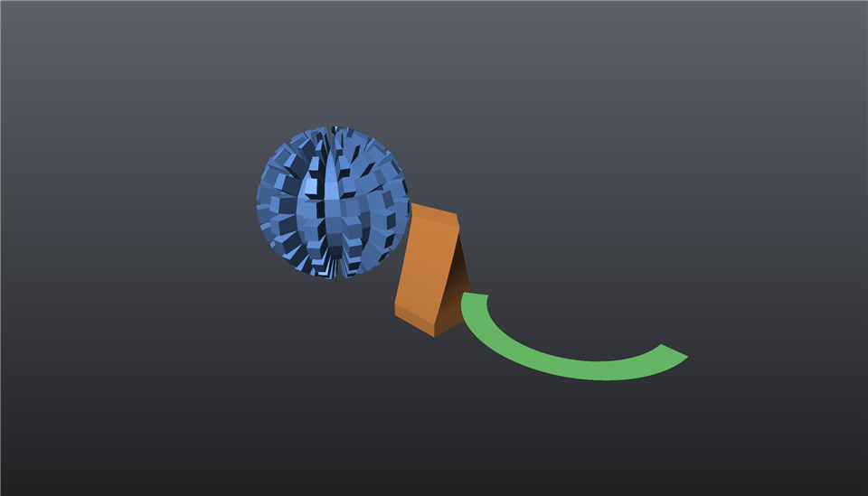

#### PolyBevel

`polybevel` — bevels edges and points: round, chamfer, crease and solid profiles, divisions, profile ramps and
curves, collision handling.

```cpp
GN_NodeId bevel;
gnCreateNode(s, geo, "polybevel", "bevel1", false, &bevel);
gnConnectNodeInput(s, bevel, 0, input, 0);
const float distance = 0.2f;
gnSetParmFloatValues(s, bevel, &distance, findParm(s, bevel, "offset").floatValuesIndex, 1);
const int divisions = 4;
gnSetParmIntValues(s, bevel, &divisions, findParm(s, bevel, "divisions").intValuesIndex, 1);
setMenu(s, bevel, "filletshape", "chamfer");                  // the default profile is round
```

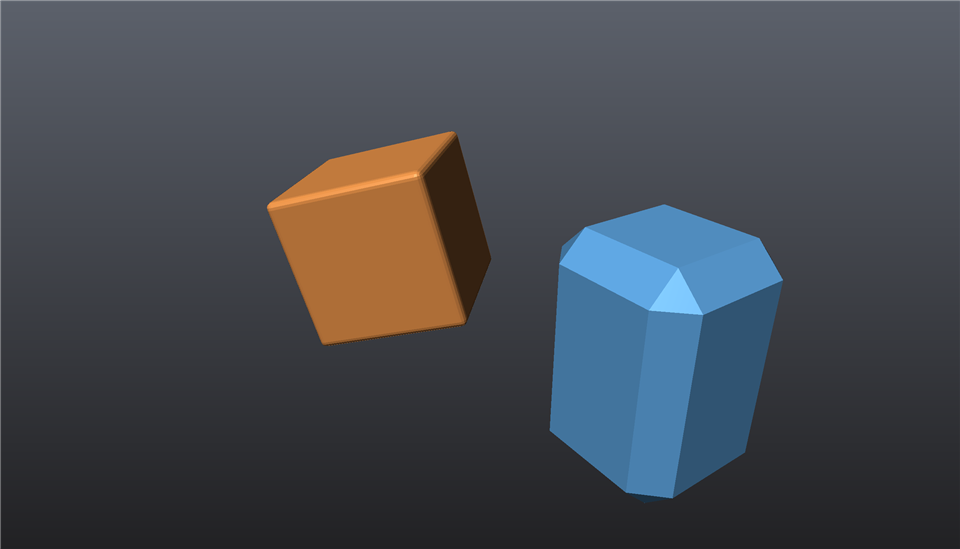

#### Boolean

`boolean` — union, intersection, subtraction and shattering of solids and surfaces (the kernel is Manifold);
attributes and groups of both inputs carry over to the result.

```cpp
GN_NodeId boolean;
gnCreateNode(s, geo, "boolean", "boolean1", false, &boolean);
gnConnectNodeInput(s, boolean, 0, solidA, 0);
gnConnectNodeInput(s, boolean, 1, solidB, 0);
setMenu(s, boolean, "booleanop", "subtract");                 // "union", "intersect", "shatter"
```


### Copies and points

#### Scatter

`scatter` — points over a surface by count or density (also from an attribute), relaxed apart; the source primitive
and its parametric coordinates are written to the points.

```cpp
GN_NodeId scatter;
gnCreateNode(s, geo, "scatter", "scatter1", false, &scatter);
gnConnectNodeInput(s, scatter, 0, surface, 0);
const int count = 500, relax = 1;
gnSetParmIntValues(s, scatter, &count, findParm(s, scatter, "npts").intValuesIndex, 1);
gnSetParmIntValues(s, scatter, &relax, findParm(s, scatter, "relaxpoints").intValuesIndex, 1);
const float seed = 3;
gnSetParmFloatValues(s, scatter, &seed, findParm(s, scatter, "seed").floatValuesIndex, 1);
```

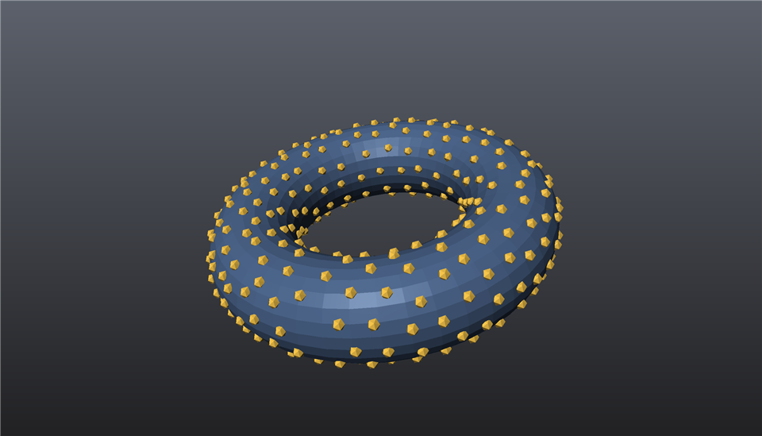

#### Copy to Points

`copytopoints` — copies of the first input onto the points of the second, oriented by `N`, `up` or `orient`, scaled by
`pscale` and `scale`, with attributes taken from the target points.

```cpp
GN_NodeId copy;
gnCreateNode(s, geo, "copytopoints", "copy1", false, &copy);
gnConnectNodeInput(s, copy, 0, shape, 0);                     // what to copy
gnConnectNodeInput(s, copy, 1, points, 0);                    // where: points with N, pscale, Cd, ...
setMenu(s, copy, "pivot", "origin");
// Attributes from Target: a multiparm of rows, each with a pattern of attribute names
const int rows = 1;
gnSetParmIntValues(s, copy, &rows, findParm(s, copy, "targetattribs").intValuesIndex, 1);
gnSetParmStringValue(s, copy, "Cd", findParm(s, copy, "applyattribs1").id, 0);
// Only some of the target points
gnSetParmStringValue(s, copy, "0-49", findParm(s, copy, "targetgroup").id, 0);
```

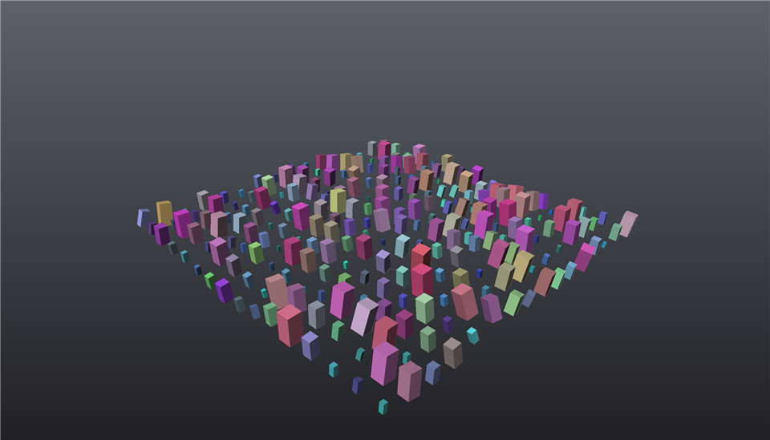

#### Copy and Transform

`copyxform` — N copies of the input, copy k transformed by the parameters applied k times (translate, rotate, scale,
pivot).

```cpp
GN_NodeId copies;
gnCreateNode(s, geo, "copyxform", "stairs", false, &copies);
gnConnectNodeInput(s, copies, 0, step, 0);
const int count = 20;
gnSetParmIntValues(s, copies, &count, findParm(s, copies, "ncy").intValuesIndex, 1);
const float t[] = {0, 0.2f, 0}, r[] = {0, 18, 0}, scale = 0.97f;   // per copy
gnSetParmFloatValues(s, copies, t, findParm(s, copies, "t").floatValuesIndex, 3);
gnSetParmFloatValues(s, copies, r, findParm(s, copies, "r").floatValuesIndex, 3);
gnSetParmFloatValues(s, copies, &scale, findParm(s, copies, "scale").floatValuesIndex, 1);
```


### Curves

#### Fit

`fit` — NURBS or Bezier curves through the points of polylines: global and local interpolation, breakpoints,
approximation within a tolerance. Curves are read back with `gnGetCurveInfo`, `gnGetCurveCounts`, `gnGetCurveKnots`.

```cpp
GN_NodeId fit;
gnCreateNode(s, geo, "fit", "fit1", false, &fit);
gnConnectNodeInput(s, fit, 0, polyline, 0);
setMenu(s, fit, "method", "interp");                          // the curve passes through every point
setMenu(s, fit, "type", "nurbs");                             // "bezier"

// After the cook: the curve part (parts go mesh, polylines, NURBS, Bezier)
GN_PartInfo part;
gnGetPartInfo(s, fit, curvePart, &part);                      // part.type == GN_PARTTYPE_CURVE
GN_CurveInfo curve;
gnGetCurveInfo(s, fit, curvePart, &curve);
std::vector<float> knots(curve.knotCount);
gnGetCurveKnots(s, fit, curvePart, knots.data(), 0, curve.knotCount);
```

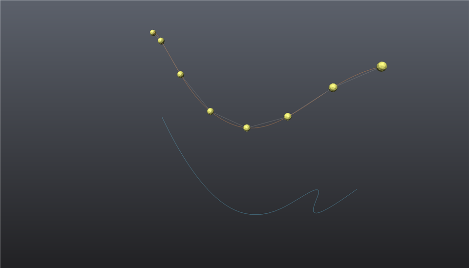

#### Resample

`resample` — evenly spaced points along polylines and curves, by segment length or number of segments; polylines can
be treated as subdivision curves.

```cpp
GN_NodeId resample;
gnCreateNode(s, geo, "resample", "resample1", false, &resample);
gnConnectNodeInput(s, resample, 0, curve, 0);
const float length = 0.25f;
gnSetParmFloatValues(s, resample, &length, findParm(s, resample, "length").floatValuesIndex, 1);
setMenu(s, resample, "treatpolysas", "subd");                 // smooth polylines as subdivision curves
```

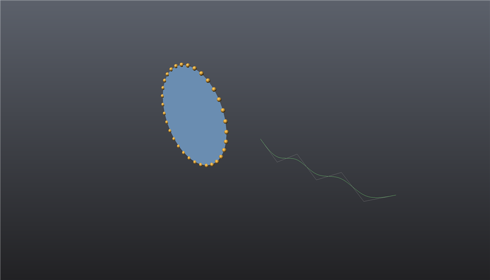

#### Carve

`carve` — cuts the piece of every curve between two parametric positions (or by arc length) and extracts points.

```cpp
GN_NodeId carve;
gnCreateNode(s, geo, "carve", "carve1", false, &carve);
gnConnectNodeInput(s, carve, 0, curve, 0);
const int on = 1;
gnSetParmIntValues(s, carve, &on, findParm(s, carve, "firstu").intValuesIndex, 1);
gnSetParmIntValues(s, carve, &on, findParm(s, carve, "secondu").intValuesIndex, 1);
const float u1 = 0.2f;
gnSetParmFloatValues(s, carve, &u1, findParm(s, carve, "domainu1").floatValuesIndex, 1);
gnSetParmExpression(s, carve, "0.2 + 0.8 * abs(sin($T))", findParm(s, carve, "domainu2").id, 0);   // a growing piece
```

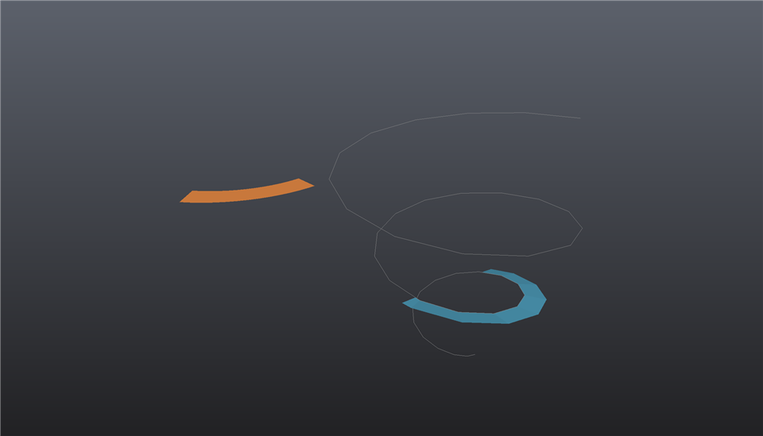

#### Join

`join` — joins curves end to start into one, with a smooth blend or a straight span; nearest ends, groups of N, wrap.

```cpp
GN_NodeId join;
gnCreateNode(s, geo, "join", "join1", false, &join);
gnConnectNodeInput(s, join, 0, curves, 0);                    // several curves in one geometry
const int blend = 1;
gnSetParmIntValues(s, join, &blend, findParm(s, join, "blend").intValuesIndex, 1);
const float tolerance = 0.5f, bias = 0.5f;
gnSetParmFloatValues(s, join, &tolerance, findParm(s, join, "tolerance").floatValuesIndex, 1);
gnSetParmFloatValues(s, join, &bias, findParm(s, join, "bias").floatValuesIndex, 1);
```

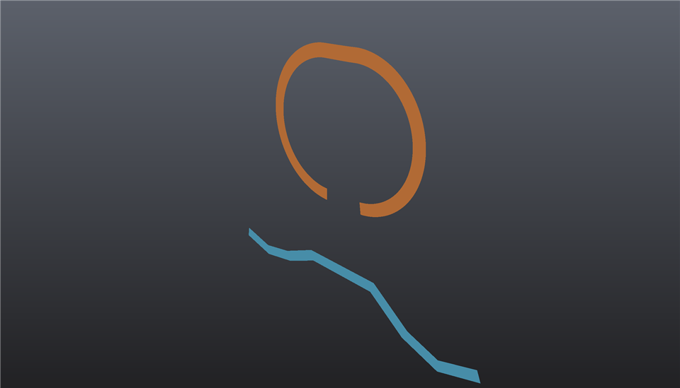

#### Orient along Curve

`orientalongcurve` — a frame at every point of a curve (tangent, up vector, roll and twists) written as `N` / `up`,
`orient` or matrices; Copy to Points then orients copies by it.

```cpp
GN_NodeId orient;
gnCreateNode(s, geo, "orientalongcurve", "frames", false, &orient);
gnConnectNodeInput(s, orient, 0, curve, 0);
setMenu(s, orient, "upvectortype", "y");
const int roll = 1, twists = 1;
gnSetParmIntValues(s, orient, &roll, findParm(s, orient, "applyroll").intValuesIndex, 1);
setMenu(s, orient, "rollper", "fulledges");
gnSetParmIntValues(s, orient, &twists, findParm(s, orient, "fulltwists").intValuesIndex, 1);   // one full turn
gnSetParmExpression(s, orient, "$T * 45", findParm(s, orient, "roll").id, 0);

GN_NodeId copy;
gnCreateNode(s, geo, "copytopoints", "along", false, &copy);
gnConnectNodeInput(s, copy, 0, shape, 0);
gnConnectNodeInput(s, copy, 1, orient, 0);
```


### Networks and objects

#### Merge

`merge` — the geometry of up to 10 inputs combined in input order; attributes and groups of all inputs are united.

```cpp
GN_NodeId merge;
gnCreateNode(s, geo, "merge", "merge1", false, &merge);
gnConnectNodeInput(s, merge, 0, sphere, 0);
gnConnectNodeInput(s, merge, 1, box, 0);
gnConnectNodeInput(s, merge, 2, torus, 0);
gnSetNodeDisplay(s, merge, 1);
```

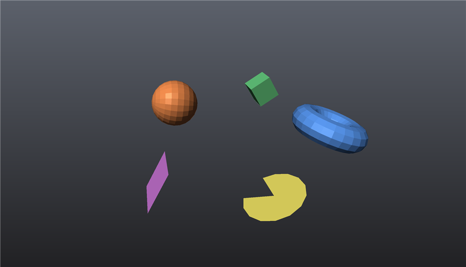

#### Null

`null` — passes its input through. A typical use is a control node: user (spare) parameters added with
`gnAddSpareParm` and read by other nodes with `ch()`.

```cpp
GN_NodeId ctrl;
gnCreateNode(s, geo, "null", "CTRL", false, &ctrl);
GN_SpareParmTemplate parm{};
parm.type = GN_PARMTYPE_FLOAT;
parm.name = "radius";
parm.label = "Radius";
parm.size = 1;
parm.defaults[0] = 2;
parm.hasRange = true;
parm.min = 0.1;
parm.max = 5;
GN_ParmId radiusId;
gnAddSpareParm(s, ctrl, &parm, -1, &radiusId);

// Other nodes read the control; changing it re-cooks only the nodes that depend on it
gnSetParmExpression(s, sphere, "ch(\"../CTRL/radius\")", findParm(s, sphere, "rad").id, 0);
gnSetParmExpression(s, torus, "ch(\"/obj/geo1/CTRL/radius\") * 1.5", findParm(s, torus, "rad").id, 0);
const float radius = 3;
gnSetParmFloatValues(s, ctrl, &radius, findParm(s, ctrl, "radius").floatValuesIndex, 1);
```

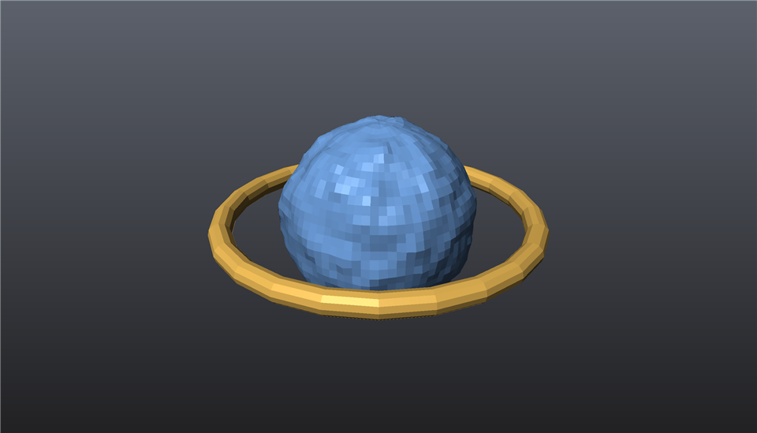

#### Subnet

`subnet` — a SOP network inside a SOP: up to 4 inputs come in through the input nodes "1".."4" inside it, the result
goes out through its Display SOP or Output SOPs.

```cpp
GN_NodeId subnet;
gnCreateNode(s, geo, "subnet", "subnet1", false, &subnet);
gnConnectNodeInput(s, subnet, 0, sourceA, 0);
gnConnectNodeInput(s, subnet, 1, sourceB, 0);

// The input nodes "1".."4" are listed with the GN_NODEFLAGS_SOP_SUBNET_INPUT filter
int count = 0;
gnComposeChildNodeList(s, subnet, GN_NODETYPE_ANY, GN_NODEFLAGS_SOP_SUBNET_INPUT, false, &count);
std::vector<GN_NodeId> inputs(count);
gnGetComposedChildNodeList(s, subnet, inputs.data(), count);
GN_NodeId input1 = -1, input2 = -1;
for (GN_NodeId id : inputs) {
    GN_NodeInfo info;
    gnGetNodeInfo(s, id, &info);
    const std::string name = getString(s, info.nameSH);
    if (name == "1") input1 = id;
    if (name == "2") input2 = id;
}

// A network inside: its Display SOP is the output of the subnet
GN_NodeId xform, merge;
gnCreateNode(s, subnet, "xform", "move", false, &xform);
gnConnectNodeInput(s, xform, 0, input1, 0);
gnCreateNode(s, subnet, "merge", "result", false, &merge);
gnConnectNodeInput(s, merge, 0, xform, 0);
gnConnectNodeInput(s, merge, 1, input2, 0);
gnSetNodeDisplay(s, merge, 1);
```

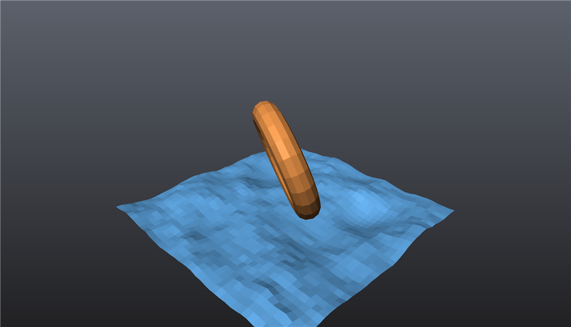

#### Output

`output` — chooses which geometry goes to which output of a subnet (Output Index 0, 1, ...).

```cpp
// Inside a subnet: two Output SOPs
GN_NodeId out0, out1;
gnCreateNode(s, subnet, "output", "output0", false, &out0);
gnConnectNodeInput(s, out0, 0, topHalf, 0);
gnCreateNode(s, subnet, "output", "output1", false, &out1);
gnConnectNodeInput(s, out1, 0, bottomHalf, 0);
const int index = 1;
gnSetParmIntValues(s, out1, &index, findParm(s, out1, "outputidx").intValuesIndex, 1);

// Outside: nodes connected to output 0 and output 1 of the subnet
gnConnectNodeInput(s, moveUp, 0, subnet, 0);
gnConnectNodeInput(s, moveDown, 0, subnet, 1);
```

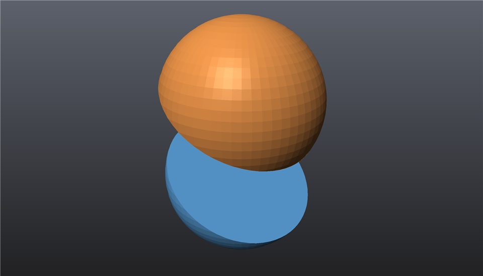

#### Geo objects

`Object/geo` — an object on `/obj` holding a SOP network, with its own transform (translate, rotate, scale, pivot,
transform order). Geometry is read in object space; `gnGetObjectTransform` gives the matrix that takes it to the world.

```cpp
GN_NodeId object, box;
gnCreateNode(s, 0, "geo", "spinner", false, &object);
gnCreateNode(s, object, "box", "shape", false, &box);
const float t[] = {-4, 0, 0}, scale[] = {1, 2, 1};
gnSetParmFloatValues(s, object, t, findParm(s, object, "t").floatValuesIndex, 3);
gnSetParmFloatValues(s, object, scale, findParm(s, object, "s").floatValuesIndex, 3);
setMenu(s, object, "xOrd", "trs");
gnSetParmExpression(s, object, "$T * 90", findParm(s, object, "r").id, 1);
gnSetNodeDisplay(s, object, 1);                               // object visibility

// The world matrix for the renderer: 16 floats, row vectors (p' = p * M)
GN_Transform xf;
gnGetObjectTransform(s, object, -1, GN_SRT, &xf);
float matrix[16];
gnConvertTransformQuatToMatrix(s, &xf, matrix);
```

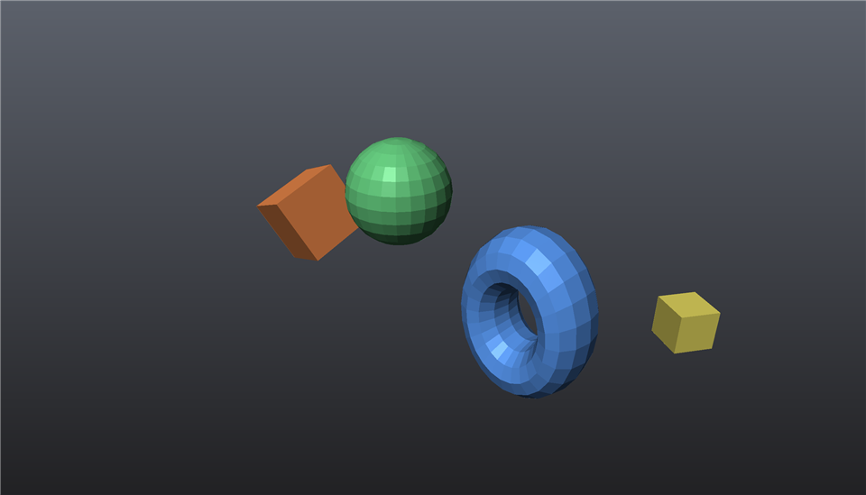

#### Null objects

`Object/null` — objects without geometry used as parents: input 0 of an object is its parent, the world matrix of a
child is its local matrix times the world matrix of the parent.

```cpp
GN_NodeId pivot, planet;
gnCreateNode(s, 0, "null", "orbit", false, &pivot);
gnSetParmExpression(s, pivot, "$T * 40", findParm(s, pivot, "r").id, 1);   // the null turns...

gnCreateNode(s, 0, "geo", "planet", false, &planet);
const float t[] = {5, 0, 0};
gnSetParmFloatValues(s, planet, t, findParm(s, planet, "t").floatValuesIndex, 3);
gnConnectNodeInput(s, planet, 0, pivot, 0);                   // ...and carries its child around

GN_Transform world;
gnGetObjectTransform(s, planet, -1, GN_SRT, &world);          // orbit · planet
```

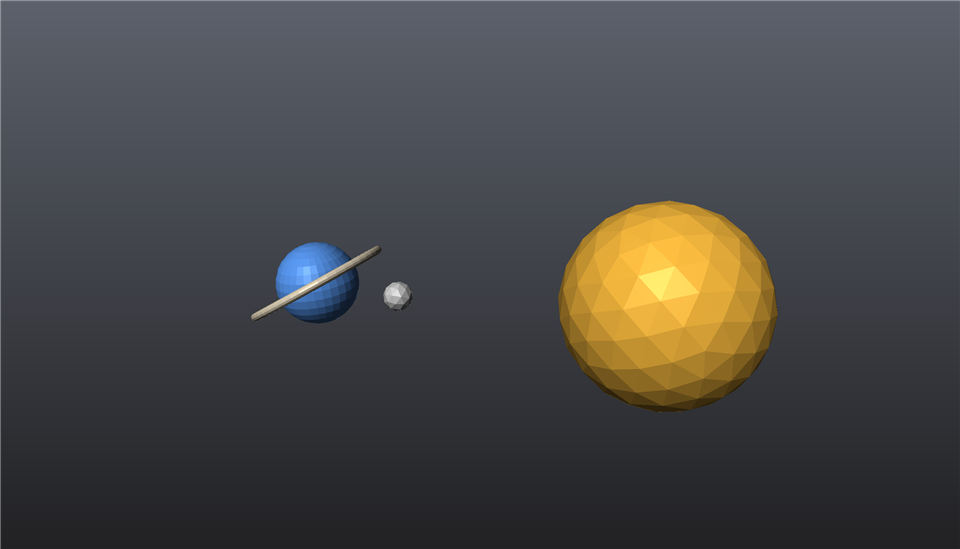

### Geometry from the application

#### Input nodes

`gnCreateInputNode` and the geometry setters, as the input nodes of HAPI: a mesh or curves computed by the application
— points, faces, attributes of any class, groups — handed to the graph. `gnCommitGeo` locks the node with this
geometry, and any operator can work on it.

```cpp
// A mesh: a quad and a triangle
GN_NodeId mesh;
gnCreateInputNode(s, -1, &mesh, "mesh");                      // a new object: /obj/input_mesh/input_mesh
GN_PartInfo part{};
part.type = GN_PARTTYPE_MESH;
part.pointCount = 5;
part.vertexCount = 7;
part.faceCount = 2;
gnSetPartInfo(s, mesh, 0, &part);

const float positions[] = {0, 0, 0, 1, 0, 0, 1, 1, 0, 0, 1, 0, 2, 0.5f, 0};
GN_AttributeInfo p{};
p.exists = true;
p.owner = GN_ATTROWNER_POINT;
p.storage = GN_STORAGETYPE_FLOAT;
p.count = 5;
p.tupleSize = 3;
p.typeInfo = HAPI_ATTRIBUTE_TYPE_POINT;
gnAddAttribute(s, mesh, 0, "P", &p);
gnSetAttributeFloatData(s, mesh, 0, "P", &p, positions, 0, 5);

const int vertices[] = {0, 3, 2, 1, 1, 2, 4};                 // the points of the faces, face after face
const int faceCounts[] = {4, 3};
gnSetVertexList(s, mesh, 0, vertices, 0, 7);
gnSetFaceCounts(s, mesh, 0, faceCounts, 0, 2);

const char* names[] = {"quad", "triangle"};                   // a string primitive attribute
GN_AttributeInfo name = p;
name.owner = GN_ATTROWNER_PRIM;
name.storage = GN_STORAGETYPE_STRING;
name.count = 2;
name.tupleSize = 1;
name.typeInfo = HAPI_ATTRIBUTE_TYPE_NONE;
gnAddAttribute(s, mesh, 0, "name", &name);
gnSetAttributeStringData(s, mesh, 0, "name", &name, names, 0, 2);

const int corner[] = {1, 0, 0, 0, 0};                         // a point group
gnAddGroup(s, mesh, 0, GN_GROUPTYPE_POINT, "corner");
gnSetGroupMembership(s, mesh, 0, GN_GROUPTYPE_POINT, "corner", corner, 0, 5);
gnCommitGeo(s, mesh);

// A curve: a closed NURBS curve of order 4 through 8 CVs
GN_NodeId curve;
gnCreateInputNode(s, -1, &curve, "curve");
GN_PartInfo curvePart{};
curvePart.type = GN_PARTTYPE_CURVE;
curvePart.pointCount = 8;
curvePart.vertexCount = 8;
curvePart.faceCount = 1;                                      // one curve
gnSetPartInfo(s, curve, 0, &curvePart);
GN_CurveInfo info{};
info.curveType = GN_CURVETYPE_NURBS;
info.curveCount = 1;
info.vertexCount = 8;
info.order = 4;
info.isClosed = true;
gnSetCurveInfo(s, curve, 0, &info);
const int cvCount = 8;
gnSetCurveCounts(s, curve, 0, &cvCount, 0, 1);
GN_AttributeInfo cv = p;
cv.count = 8;
gnAddAttribute(s, curve, 0, "P", &cv);
gnSetAttributeFloatData(s, curve, 0, "P", &cv, cvPositions, 0, 8);
gnCommitGeo(s, curve);

// Operators on the input geometry: a node in the same object
GN_NodeInfo meshInfo;
gnGetNodeInfo(s, mesh, &meshInfo);
GN_NodeId extrude;
gnCreateNode(s, meshInfo.parentId, "polyextrude", "extrude", false, &extrude);
gnConnectNodeInput(s, extrude, 0, mesh, 0);
```

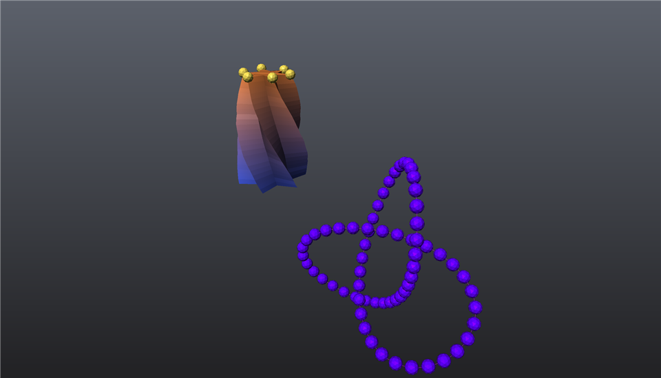

#### Input nodes and Boolean

Input nodes created inside an existing geo object are ordinary SOPs of its network, so geometry from the application
can be combined with any operator — here two closed meshes made in code go into a Boolean, and the result is cooked
again every time one of them is committed anew.

```cpp
GN_NodeId solidA, solidB, boolean;
gnCreateInputNode(s, geo, &solidA, "a");                      // /obj/geo1/input_a
gnCreateInputNode(s, geo, &solidB, "b");                      // /obj/geo1/input_b
// ... gnSetPartInfo, gnAddAttribute, gnSetAttributeFloatData, gnSetVertexList, gnSetFaceCounts and
//     gnCommitGeo for each, as above (faces go clockwise seen from outside)

gnCreateNode(s, geo, "boolean", "a_minus_b", false, &boolean);
gnConnectNodeInput(s, boolean, 0, solidA, 0);
gnConnectNodeInput(s, boolean, 1, solidB, 0);
setMenu(s, boolean, "booleanop", "subtract");
gnSetNodeDisplay(s, boolean, 1);

// An animated input: set new positions of B and commit again — only B and the Boolean are cooked anew
gnSetAttributeFloatData(s, solidB, 0, "P", &pB, movedPositions, 0, pointCountB);
gnCommitGeo(s, solidB);
```

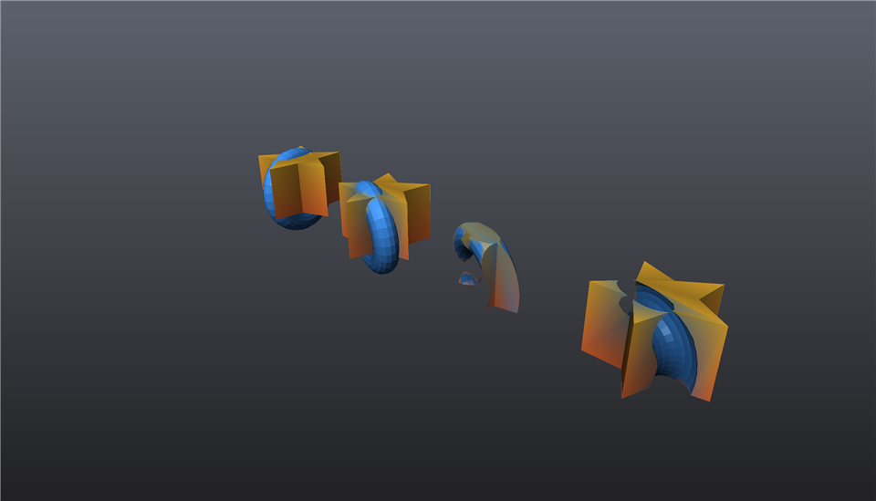
